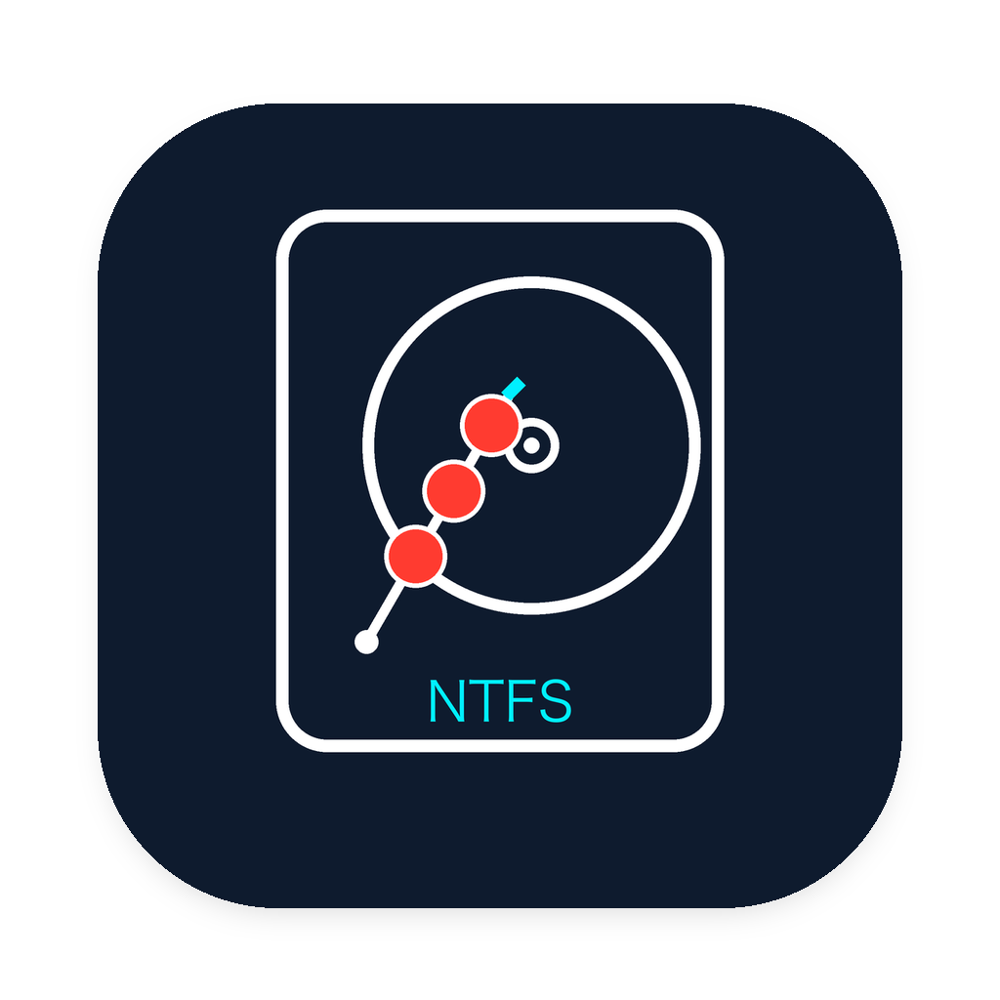
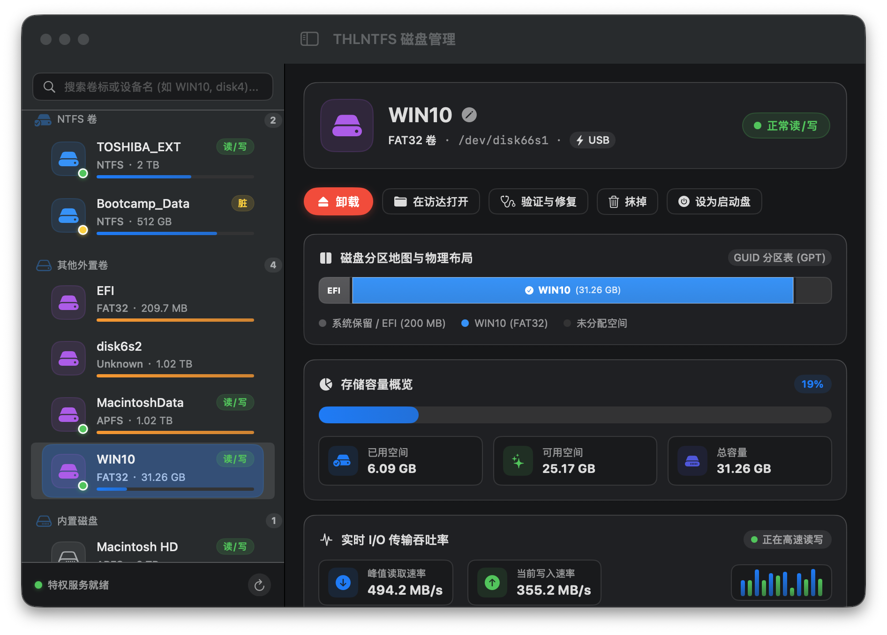
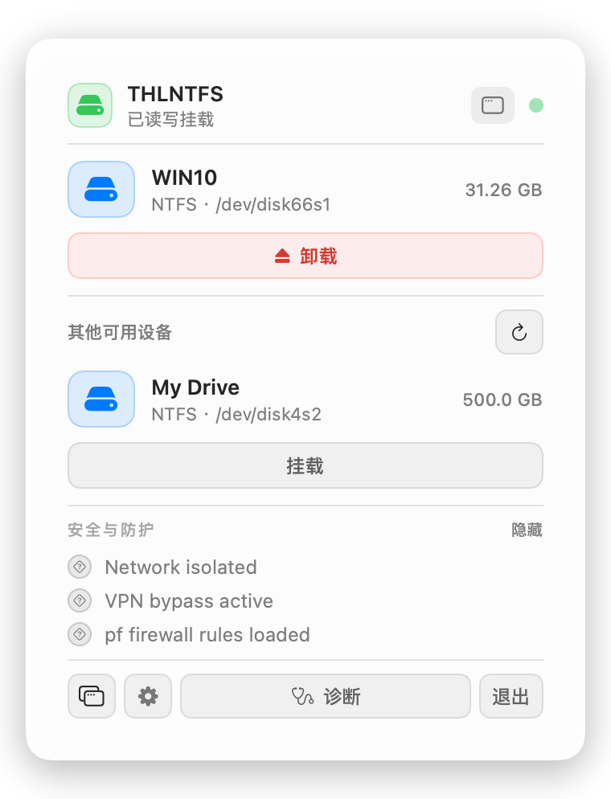
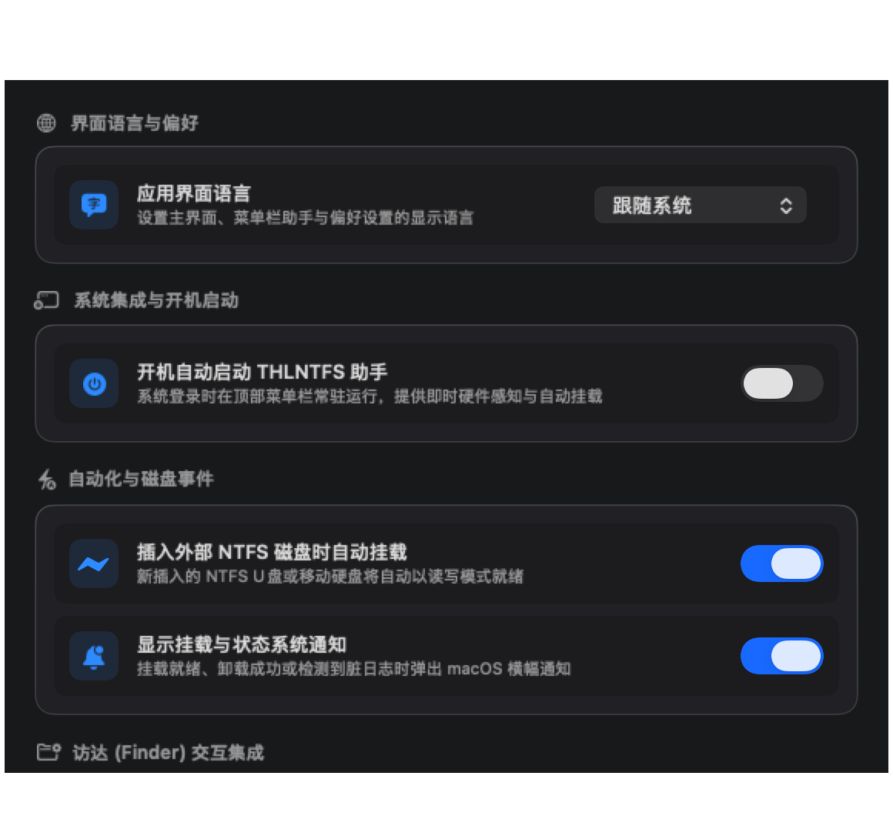

   
  <h1 align="center">THLNTFS for Mac</h1>

  <strong>专为 Apple Silicon 打造的现代化 NTFS 外置磁盘管理工具</strong> 
  完全免关闭 SIP · 零内核扩展 (No KEXT) · 即插即用高速读写 · 原生防拔盘崩溃保护

  
  
  
  
  

---

## 💡 为什么选择 THLNTFS？

在 Mac 上读写 NTFS 硬盘，传统工具通常需要你**降低系统安全性**、**关闭 SIP（系统完整性保护）**或安装陈旧的内核扩展，容易引起系统崩溃（Kernel Panic）。

**THLNTFS** 彻底改变了这一现状：无需关闭 SIP，无需加载任何内核扩展，即可安全、高速地对 NTFS 及 Linux 外置磁盘进行完整读写。

  

---

## ✨ 核心特性

- 🛡️ **100% 保持系统安全**：完全遵从 Apple 现代安全规范，SIP 保护全程开启，系统升级无痛无感。
- ⚡ **意外拔盘抗崩溃**：采用软挂载弹性通信机制，意外断开或拔出移动硬盘绝不导致 macOS 死机。
- 🚀 **极速即插即用**：插入 NTFS 移动硬盘或 U 盘自动挂载读写，在访达（Finder）中无缝拷贝剪切文件。
- 🧰 **内置磁盘急救**：一键清除 Windows“快速启动”残留的脏日志，快速将未正常退出的只读磁盘恢复为可读写。
- 💾 **格式化与启动盘**：支持一键将外置磁盘抹掉格式化为 NTFS；支持识别并直接选择 Windows EFI 引导盘。
- 🎨 **原生优雅体验**：纯原生 SwiftUI 构建，提供常驻菜单栏轻量面板，支持深浅色外观与中英双语。

  
  &nbsp;&nbsp;
  

---

## 📦 下载与安装

1. 从 [Releases 页面](https://github.com/never88gone/thlntfs/releases/latest) 下载最新的 **`THLNTFS.dmg`**；
2. 双击打开镜像，将 **`THLNTFS.app`** 拖入 **`Applications`**（应用程序文件夹）；
3. **首次运行**：
   - 在“应用程序”中**右键点击** `THLNTFS.app` 选择**“打开”**；
   - 首次启动按提示使用 Touch ID 或开机密码授权辅助工具；
4. 插入 NTFS 硬盘，即可在访达中自由读写文件。

> **系统要求**：搭载 Apple Silicon 芯片的 Mac（M1 / M2 / M3 / M4 全系列），运行 macOS 14.0 (Sonoma) 或更高版本。

---

## ❓ 常见问题 (FAQ)

<b>Q: 为什么不需要在恢复模式下关闭 SIP 或降低安全性？</b>

THLNTFS 采用现代轻量硬件隔离架构，所有文件系统驱动均运行在受控的安全沙箱内，不向 macOS 宿主内核注入任何代码，因此 100% 遵从 Apple 官方安全策略。

<b>Q: 磁盘连接后显示“只读”或被 Windows 锁定怎么办？</b>

这通常是因为 Windows 开启了“快速启动”或上次未安全弹出。只需在 THLNTFS 主窗口中点击<b>“急救”</b> -> <b>“运行急救并清除脏日志”</b>，即可快速恢复正常读写。

<b>Q: 碰到数据线或意外拔出会造成 Mac 死机吗？</b>

不会。底层已做好完备的 I/O 挂起解除保护，杜绝 Kernel Panic，保护您的系统与数据安全。

---

## 🧱 第三方开源库 (Third-Party Libraries)

THLNTFS 基于以下开源组件构建，以独立子进程或隔离微虚拟机沙箱形式安全调度，遵循各自开源许可证：

| 组件名称 | 许可协议 | 用途说明 |
| :--- | :--- | :--- |
| **[anylinuxfs](https://github.com/nohajc/anylinuxfs)** | GPL-3.0 | 宿主端微虚拟机挂载与文件系统调度引擎 |
| **[Linux Kernel (libkrunfw)](https://github.com/nohajc/libkrunfw)** | GPL-2.0 | 定制极简 ARM64 虚拟化内核，内置 NTFS-3G 驱动引擎 |
| **[libkrun](https://github.com/containers/libkrun)** | Apache-2.0 | 轻量 MicroVM 虚拟机运行时，提供硬件级独立安全隔离 |
| **[vmnet-helper](https://github.com/nirs/vmnet-helper)** | Apache-2.0 | Apple 虚拟机网络特权网桥辅助程序 |
| **[gvproxy](https://github.com/containers/gvisor-tap-vsock)** | Apache-2.0 | 虚拟网络与 VSOCK 隧道高速代理 |
| **[Alpine Linux](https://alpinelinux.org)** | Mixed | 极简客机用户态基础镜像，提供存储检查与维护工具 |

在 App 内部亦可随时查阅：进入 **偏好设置** -> **诊断与关于** -> **开源组件与第三方库** 即可浏览详细清单、跳转上游主页或查阅许可证声明。

完整许可声明与版权说明详见 [THIRD_PARTY_LICENSES.md](THIRD_PARTY_LICENSES.md)。

---

## 📄 开源许可

本项目遵循 [GPL-2.0](LICENSE.md) 开源协议。
