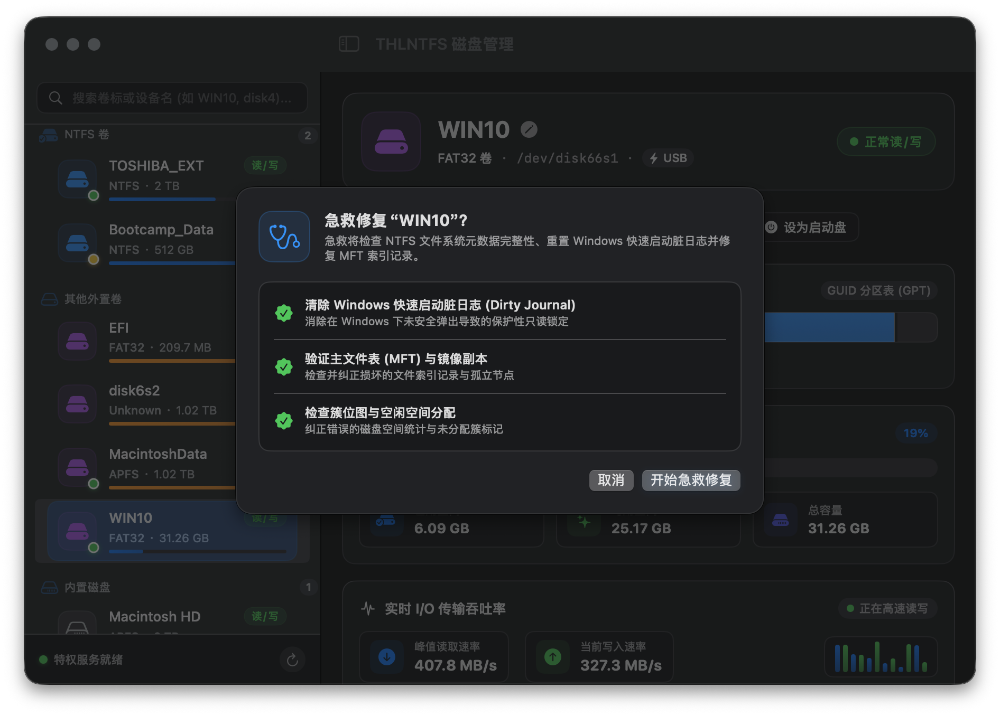
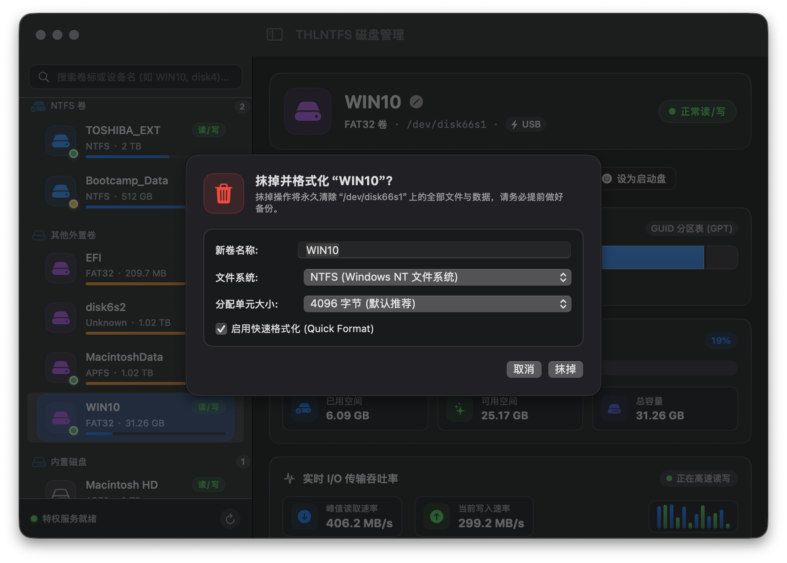
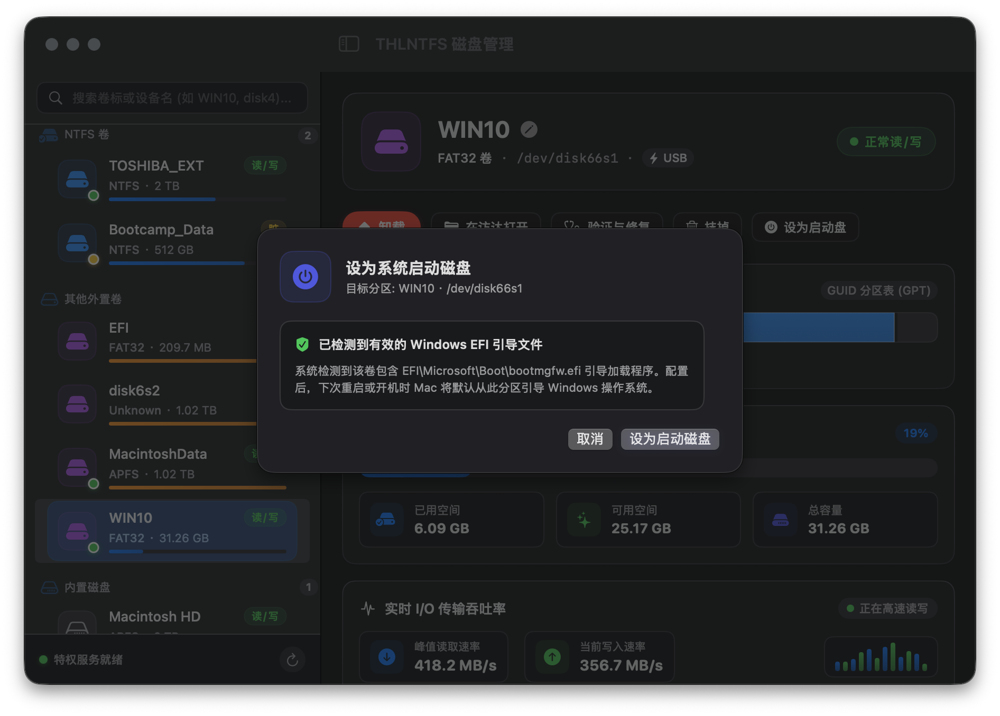
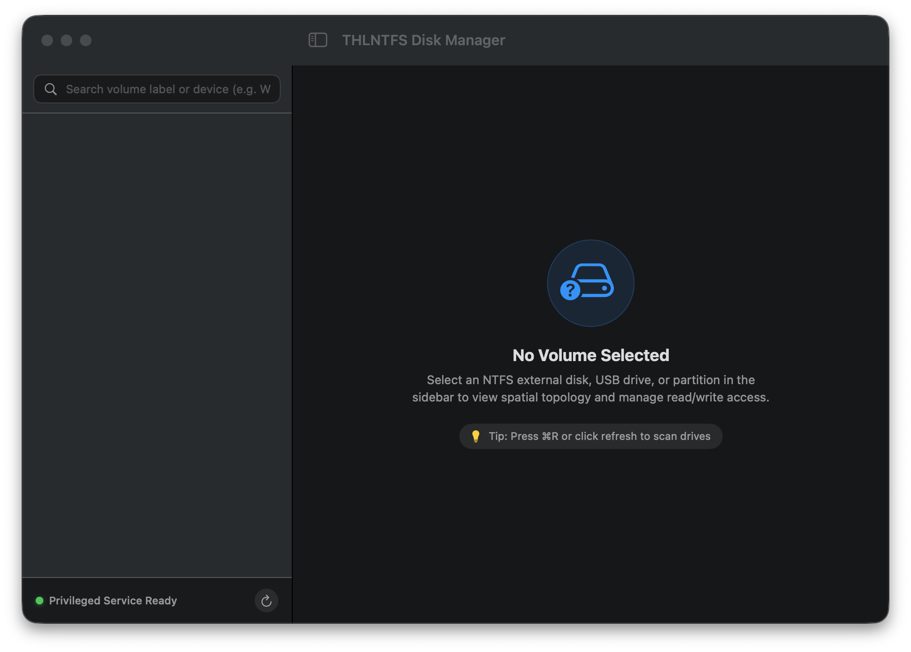
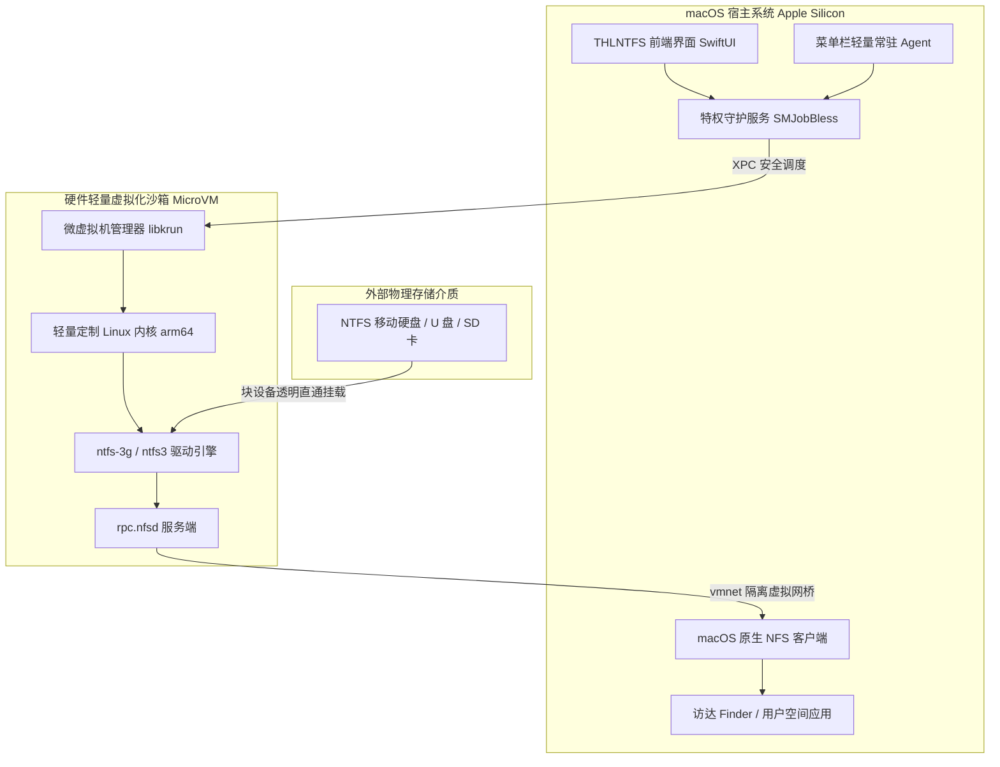

<p align="center">
  <br>
  <h1 align="center">THLNTFS for Mac</h1>
</p>

<p align="center">
  <strong>现代化高能级 NTFS 与 Linux 外置磁盘管理系统</strong><br>
  原生支持 Apple Silicon · 100% 保持系统 SIP 保护开启 · 零系统内核扩展 (No KEXT) · 硬件微虚拟化安全隔离
</p>

<p align="center">
  
  
  
  
  
  
</p>

---

## 📖 简介 (Overview)

**THLNTFS** 是一款专为搭载 Apple Silicon（M1 / M2 / M3 / M4 系列）的 Mac 设备量身打造的下一代外置存储管理工具。

长期以来，在 Mac 上实现对 NTFS 分区的读写，传统方案往往要求用户进入恢复模式（Recovery）降低系统安全性、强制关闭系统完整性保护（SIP），或者加载容易引起 Kernel Panic（系统内核崩溃）的第三方 KEXT 驱动。

**THLNTFS 彻底终结了这种妥协**：
- **完全免禁 SIP**：100% 遵从 Apple 现代化安全规范，系统完整性保护全程开启；
- **零 KEXT 内核扩展**：不向 macOS 内核注入任何不稳定代码，系统升级无痛且安全；
- **微虚拟机硬件隔离传输**：通过超轻量微虚拟机（MicroVM）在隔离沙箱中挂载驱动，并通过专用高速网络通道与统一内存优化进行读写，既保障高速吞吐，又杜绝意外拔盘造成的宿主机死机崩溃；
- **全栈原生界面**：采用全新现代 SwiftUI 开发，深度适配 macOS 原生毛玻璃质感、系统深浅色外观及 Retina 视网膜高清渲染。

---

## 🖥️ 核心界面一览 (Visual Showcase)

### 1. 现代化主看板 (Main Dashboard)
提供直观的多分区导航、物理硬件参数详情、GPT 空间切片图、动态 I/O 速率监控与常用快捷动作（一键在访达中打开、卸载、装载等）。

<p align="center">
  
</p>

---

### 2. 菜单栏轻量控制中心 (Menu Bar Center)
常驻系统菜单栏，无论您正在处理何种工作，轻轻一点即可获知外置驱动器状态，一键安全卸载或快速切换读写通道。

<p align="center">
  
</p>

---

## ✨ 核心特性矩阵 (Key Features)

### 1. 🛡️ 极致安全与抗拔保护
- **100% 保持 SIP 安全开启**：无需重启关机，无需关闭系统安全保护。
- **防止意外拔盘内核恐慌 (Kernel Panic)**：底座传输采用软挂载（`soft mount`）通信与无状态重连机制，无论意外断电还是手滑拔出连接线，系统级进程绝不卡死。
- **特权辅助服务安全隔离**：严格遵循 Apple 官方 `SMJobBless` 规范，前端主程序零 `sudo` 提权，核心高危系统调用由隔离的特权助手守护进程受控执行。

### 2. 🧰 专业级磁盘维护与急救工具箱

| 功能模块 | 说明 | 界面预览 |
| :--- | :--- | :---: |
| **磁盘急救与脏日志修复**<br>*(First Aid & Journal Clean)* | 快速扫描 NTFS 文件系统状态，一键清除因 Windows 快速启动（Fast Startup）或异常关机残留的未提交事务脏日志，快速将卷恢复至干净就绪态。 | [查看图解](#磁盘急救) |
| **抹掉并格式化为 NTFS**<br>*(Erase & Format)* | 支持将任意非启动分区一键格式化为兼容 Windows 的标准 NTFS 文件系统；灵活提供 **4KB 至 64KB** 自定义簇大小分配，支持快速格式化。 | [查看图解](#格式化为ntfs) |
| **Windows EFI 启动盘指定**<br>*(Startup Disk Selector)* | 智能检测并定位包含 Windows EFI Bootloader 的外置引导介质，支持在 macOS 中直接一键指定为下次开机启动项。 | [查看图解](#windows启动盘指定) |

#### 磁盘急救
<p align="center">
  
</p>

#### 格式化为NTFS
<p align="center">
  
</p>

#### Windows启动盘指定
<p align="center">
  
</p>

---

### 3. 🌐 全链路双语与深度偏好设置

- **中英双语无缝切换**：全界面文本遵循 Apple 原生 Localization 规范，支持中文与英文随系统语言自动响应或独立自选；
- **偏好设置与后台服务控制**：支持随系统开机自动静默启动、新插入 NTFS 磁盘自动接管读写、Mac 进入睡眠时自动同步缓存以保障安全。

<p align="center">
  
  
</p>

---

## 🏗️ 架构与底层工作原理 (Architecture)

THLNTFS 摒弃了传统的内核级扩展模式，采用了现代化的**微型虚拟机沙箱 + 私有高速网桥 + 软挂载 NFS 导出**架构：



### 为什么这种架构更优秀？
1. **隔离崩溃域**：哪怕底层文件系统因物理坏道损坏，也仅局限在 MicroVM 沙箱内部，绝不会将 Panic 扩散至 macOS 系统本身；
2. **零权限侵入**：宿主机操作系统核心资产受 Apple SIP 全方位保护，不依赖任何违规提权；
3. **一致的高吞吐**：软挂载结合针对统一内存（Unified Memory）调整的传输参数，充分释放雷雳（Thunderbolt）及 USB 3.2 存储设备性能。

---

## 💻 系统要求 (System Requirements)

- **硬件芯片**：配备 Apple Silicon 的 Mac（M1、M2、M3、M4 系列及 Pro / Max / Ultra 型号）；
- **系统版本**：macOS 14.0 (Sonoma) 或更高版本（完整测试通过 macOS 15 Sequoia）；
- **系统安全策略**：默认推荐状态（SIP 完整开启）。

---

## 🚀 下载与安装使用 (Installation & Quick Start)

### 方式一：直接安装 DMG 发布包

1. 前往发布包产物目录或 Releases 下载最新的 **`THLNTFS.dmg`**；
2. 双击打开镜像，将 **`THLNTFS.app`** 拖拽至 **`Applications`**（应用程序）文件夹；
3. **首次启动说明**：
   - 本应用采用免开发者年费的本地自签名（Ad-hoc Code Signing）机制；
   - 首次打开时，请在访达（Finder）中**右键点击** `THLNTFS.app`，选择 **“打开”**，并在系统安全警示弹窗中点击 **“打开”**；
4. **特权服务授权**：
   - 首次启动时，系统会弹出辅助工具授权提示，请使用 Touch ID 或输入开机密码以安装特权辅助工具；
5. **即插即用**：
   - 插入 NTFS 格式的移动硬盘或 U 盘，应用将自动识别并完成极速读写装载！

---

## 🛠️ 源码构建与开发 (Build from Source)

本项目采用 Swift Package Manager (SPM) 协同构建，支持在本地一键完成代码编译、依赖集成、打包与签名。

### 1. 运行测试套件
```bash
# 执行全部 186 个单元测试与逻辑断言
swift test
```

### 2. 编译并打包应用 (.app)
```bash
# 自动编译 Release 可执行文件、集成 Helper、构建包资源与完成签名
./build/package-app.sh
```
> 打包成功后，完整的应用包将输出至：`dist/THLNTFS.app`

### 3. 一键制作 DMG 分发镜像 (.dmg)
```bash
# 打包生成便携式拖拽安装 DMG 镜像文件
./build/make-dmg.sh
```
> 生成的安装包位于：`dist/THLNTFS.dmg`

---

## 📋 常见问题解答 (FAQ)

### Q: 为什么我在系统“安全性与隐私”中找不到允许加载内核扩展的选项？
> **A:** 因为 THLNTFS **根本不使用任何内核扩展**！您不需要去降低系统安全性，直接启动即可运行。

### Q: 插入硬盘提示“只读”或被 Windows 锁定怎么办？
> **A:** 这是 Windows 的“快速启动（Fast Startup）”或未正常安全弹出时留下的脏日志（Dirty Log）。只需在 THLNTFS 主面板中点击 **“急救 (First Aid)”** -> **“运行急救并清除脏日志”**，即可一键重置并恢复可读写状态。

### Q: 意外碰掉 USB 线会导致 Mac 死机吗？
> **A:** 不会。THLNTFS 底层采用 `soft mount` 弹性保护与硬件虚拟化隔离，即使物理断开连接，macOS 也能正常解除 I/O 挂起，彻底杜绝宿主机 Kernel Panic。

---

## 📄 许可证与声明 (License)

本项目遵循开源软件许可协议。本软件仅供学习与外置存储管理使用，请定期对重要数据做好备份。
